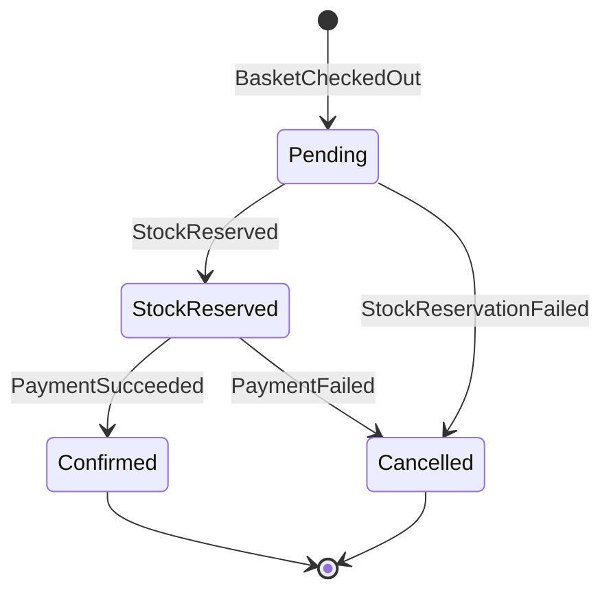
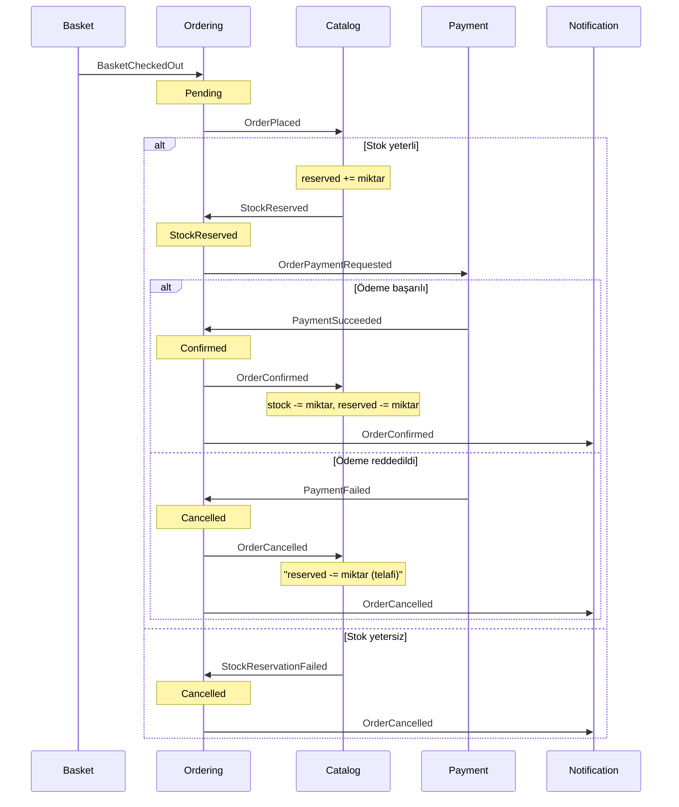

# Gereksinimler

Bu doküman sistemin ne yapacağını (fonksiyonel), nasıl davranacağını (fonksiyonel olmayan), hangi endpoint'leri sunacağını ve hangi senaryolarla doğrulanacağını tanımlar.

## Kapsam ve Varsayımlar
- Kimlik doğrulama **kapsam dışı**. Müşteri, istekte `customerId` (Guid) ile tanımlanır.
- Tek para birimi: **TRY**. `Money` value object'i para birimini taşır ama yalnızca TRY kabul edilir.
- Ödeme sağlayıcı sahtedir. **10.000 TRY üzerindeki** ödemeler reddedilir; başarısız senaryo bu kuralla üretilir.
- E-posta gönderilmez. Bildirimler loglanır ve veritabanına yazılır.
- Sepete eklenen ürünün fiyatı o an **snapshot** olarak saklanır. Sonradan fiyat değişse de sepetteki fiyat değişmez.

---

## Fonksiyonel Gereksinimler

### Catalog
| Kod | Gereksinim |
|---|---|
| FR-C1 | Ad, açıklama, fiyat ve başlangıç stoğu ile ürün oluşturulabilir |
| FR-C2 | Ürün Id ile görüntülenebilir |
| FR-C3 | Ürünler sayfalı ve isme göre aranarak listelenebilir |
| FR-C4 | Ürün fiyatı güncellenebilir (fiyat > 0) |
| FR-C5 | Ürüne stok eklenebilir (miktar > 0) |
| FR-C6 | Ürün stoğu üç değerle izlenir: `StockQuantity` (fiziksel), `ReservedQuantity` (rezerve), `AvailableQuantity = Stock - Reserved` |
| FR-C7 | `OrderPlaced` ile siparişin **tüm satırları tek seferde** rezerve edilir. Bir satır bile yetersizse hiçbiri rezerve edilmez. Sonuç olarak `StockReserved` veya `StockReservationFailed` (sebep ile) yayınlanır |
| FR-C8 | `OrderConfirmed` ile rezervasyon kesinleşir: rezerve miktar fiziksel stoktan düşülür |
| FR-C9 | `OrderCancelled` ile varsa rezervasyon serbest bırakılır (telafi adımı). Rezervasyon yoksa işlem etkisizdir |
| FR-C10 | Kullanılabilir stok hiçbir zaman negatif olamaz |
| FR-C11 | Diğer modüller ürün bilgisine yalnızca `ICatalogApi` üzerinden erişir |

### Basket
| Kod | Gereksinim |
|---|---|
| FR-B1 | Müşterinin sepeti görüntülenebilir. Sepet yoksa boş sepet döner |
| FR-B2 | Sepete ürün eklenebilir. Ürün `ICatalogApi` ile doğrulanır, fiyat snapshot alınır |
| FR-B3 | Aynı ürün tekrar eklenirse miktar artar, yeni satır oluşmaz |
| FR-B4 | İstenen toplam miktar kullanılabilir stoktan fazlaysa ekleme reddedilir. Bu erken bir kontroldür; kesin güvence rezervasyondadır (FR-C7) |
| FR-B5 | Sepetten ürün çıkarılabilir |
| FR-B6 | Sepet checkout edilebilir. Boş sepet checkout edilemez |
| FR-B7 | Checkout sonrası sepet temizlenir ve `BasketCheckedOut` event'i yayınlanır |
| FR-B8 | Checkout, sipariş Id'sini üretir ve istemciye döner. Böylece istemci sipariş durumunu takip edebilir |

### Ordering
| Kod | Gereksinim |
|---|---|
| FR-O1 | `BasketCheckedOut` event'i ile `Pending` durumunda sipariş oluşur ve `OrderPlaced` yayınlanır |
| FR-O2 | `StockReserved` ile sipariş `StockReserved` durumuna geçer ve `OrderPaymentRequested` (tutar ile) yayınlanır |
| FR-O3 | `StockReservationFailed` ile sipariş `Cancelled` olur (sebep: yetersiz stok). `OrderCancelled` yayınlanır |
| FR-O4 | `PaymentSucceeded` ile sipariş `Confirmed` olur. `OrderConfirmed` yayınlanır |
| FR-O5 | `PaymentFailed` ile sipariş `Cancelled` olur (sebep: ödeme reddi). `OrderCancelled` yayınlanır |
| FR-O6 | Geçersiz durum geçişleri reddedilir (ör. `Cancelled` -> `Confirmed`) |
| FR-O7 | Sipariş Id ile görüntülenebilir (durum, satırlar, toplam, iptal sebebi) |
| FR-O8 | Müşterinin siparişleri listelenebilir |

### Payment
| Kod | Gereksinim |
|---|---|
| FR-P1 | `OrderPaymentRequested` event'i ile sipariş tutarı için ödeme denenir. Stok rezerve edilmemiş siparişler için ödeme alınmaz |
| FR-P2 | Sonuca göre `PaymentSucceeded` veya `PaymentFailed` (sebep ile) yayınlanır |
| FR-P3 | Bir sipariş için en fazla bir ödeme kaydı oluşur |
| FR-P4 | Ödeme kaydı sipariş Id ile görüntülenebilir |

### Notification
| Kod | Gereksinim |
|---|---|
| FR-N1 | Sipariş onaylandığında müşteriye "Siparişiniz onaylandı" bildirimi oluşur |
| FR-N2 | Sipariş iptal edildiğinde müşteriye iptal sebebiyle (yetersiz stok veya ödeme reddi) bildirim oluşur |
| FR-N3 | Müşterinin bildirimleri listelenebilir |

---

## Fonksiyonel Olmayan Gereksinimler

| Kod | Kategori | Gereksinim | Nasıl doğrulanır |
|---|---|---|---|
| NFR-01 | Modülerlik | Bir modül başka modülün yalnızca `PublicApi` ve `IntegrationEvents` projelerine bağımlı olabilir | Architecture testleri (NetArchTest) |
| NFR-02 | Modülerlik | Modül iç tipleri `internal`'dır. Handler'lar `internal sealed` olur | Architecture testleri |
| NFR-03 | Veri sahipliği | Her modül yalnızca kendi şemasına erişir. Modüller arası SQL join yoktur | Ayrı `DbContext` + kod incelemesi |
| NFR-04 | Güvenilirlik | İş verisi ve yayınlanacak event aynı transaction'da kaydedilir (Outbox) | Integration testi: handler sonrası `outbox_messages` kaydı |
| NFR-05 | Güvenilirlik | Event'ler **en az bir kez** iletilir. Başarısız işleme tekrar denenir, hata kaydedilir | Integration testi: handler hatası sonrası tekrar deneme |
| NFR-06 | Idempotency | Aynı event iki kez gelse de etkisi bir kez uygulanır (Inbox) | Integration testi: aynı mesajı iki kez yayınla |
| NFR-07 | Tutarlılık | Modüller arası tutarlılık **nihai tutarlılıktır** (eventual consistency). Checkout sonrası sipariş durumu birkaç saniye içinde son haline ulaşır | Integration testi: polling ile bekleme (zaman aşımı 10 sn) |
| NFR-08 | Gözlemlenebilirlik | Tüm loglar yapısal olarak Seq'e gider. Her istek ve event akışı correlation Id ile izlenebilir | Seq'te tek correlation Id ile uçtan uca akış |
| NFR-09 | Gözlemlenebilirlik | Her command/query'nin süresi ve sonucu loglanır | Logging decorator (adım 02'de doğrulandı) |
| NFR-10 | Hata yönetimi | Tüm hata yanıtları RFC 9457 ProblemDetails formatındadır. Validation 400, NotFound 404, Conflict 409, beklenmeyen hata 500 | Integration testleri |
| NFR-11 | Hata yönetimi | Beklenmeyen hatalarda istemciye stack trace dönmez | Global exception handler |
| NFR-12 | Test edilebilirlik | Domain kuralları altyapıdan bağımsız unit test edilebilir. Saat `TimeProvider` ile soyutlanır | Domain unit testleri |
| NFR-13 | Evrimleşebilirlik | `IEventBus` soyuttur. In-memory bus, modül kodu değişmeden bir message broker ile değiştirilebilir | ADR + mikroservise ayırma rehberi |
| NFR-14 | Çalıştırılabilirlik | Sistem tek komutla ayağa kalkar (`docker compose up`). Development'ta migration'lar otomatik uygulanır | Manuel kontrol |
| NFR-15 | Sağlık | `/health` endpoint'i veritabanı bağlantısını raporlar | `GET /health` |
| NFR-16 | Dokümantasyon | Tüm endpoint'ler OpenAPI ile belgelenir ve modül adıyla gruplanır | Scalar UI |
| NFR-17 | Kod kalitesi | Build uyarısız geçer (uyarılar hata sayılır), stil kuralları build'de denetlenir | `dotnet build` |

> Performans hedefi bilinçli olarak tanımlanmadı: bu bir öğrenme projesi ve odak noktası yapısal özellikler. Ölçüm yapmadan sayı yazmak yanıltıcı olur.

---

## Endpoint'ler

### Catalog (`/catalog`)
| Metot | Yol | Gövde | Başarılı | Hatalar |
|---|---|---|---|---|
| POST | `/catalog/products` | `{ name, description, price, stockQuantity }` | 201 + `Location` | 400 |
| GET | `/catalog/products/{id}` | - | 200 (`stockQuantity`, `reservedQuantity`, `availableQuantity` dahil) | 404 |
| GET | `/catalog/products?page=1&pageSize=20&search=` | - | 200 (sayfalı) | 400 |
| PUT | `/catalog/products/{id}/price` | `{ price }` | 204 | 400, 404 |
| POST | `/catalog/products/{id}/stock` | `{ quantity }` | 204 | 400, 404 |

### Basket (`/basket`)
| Metot | Yol | Gövde | Başarılı | Hatalar |
|---|---|---|---|---|
| GET | `/basket/{customerId}` | - | 200 | - |
| POST | `/basket/{customerId}/items` | `{ productId, quantity }` | 204 | 400, 404 (ürün yok), 409 (stok yetersiz) |
| DELETE | `/basket/{customerId}/items/{productId}` | - | 204 | 404 |
| POST | `/basket/{customerId}/checkout` | - | **202** + `{ orderId }` + `Location: /orders/{orderId}` | 409 (boş sepet) |

> Checkout **202 Accepted** döner, çünkü siparişin son durumu asenkron olarak belirlenir. İstemci `Location`'daki adresi sorgulayarak takip eder.

### Ordering (`/orders`)
| Metot | Yol | Başarılı | Hatalar |
|---|---|---|---|
| GET | `/orders/{orderId}` | 200 | 404 |
| GET | `/orders?customerId=` | 200 | 400 |

### Payment (`/payments`)
| Metot | Yol | Başarılı | Hatalar |
|---|---|---|---|
| GET | `/payments/{orderId}` | 200 | 404 |

### Notification (`/notifications`)
| Metot | Yol | Başarılı | Hatalar |
|---|---|---|---|
| GET | `/notifications?customerId=` | 200 | 400 |

### Host
| Metot | Yol | Amaç |
|---|---|---|
| GET | `/health` | Sağlık kontrolü |
| GET | `/openapi/v1.json` | OpenAPI dokümanı |
| GET | `/scalar` | API arayüzü (Development) |

---

## Senaryolar

Her senaryo bir integration testine veya `Api.http` dosyasındaki bir isteğe karşılık gelir.

### S1 - Ürün yönetimi
- **Verilen:** Boş katalog
- **Yapılan:** Ürün oluştur, Id ile getir, fiyatını değiştir, stok ekle
- **Beklenen:** 201, ardından güncel fiyat ve stokla 200
- **Hata durumları:** Negatif fiyat 400, olmayan ürün 404

### S2 - Sepete ürün ekleme
- **Verilen:** Stoğu 5 olan "Kalem" ürünü
- **Yapılan:** Sepete 2 adet ekle, sonra tekrar 2 adet ekle
- **Beklenen:** Sepette tek satır, miktar 4, fiyat ürün fiyatının snapshot'ı
- **Hata durumları:**
  - Olmayan ürün: 404
  - Toplam 6 adet istenirse: 409 (stok yetersiz)
  - Miktar 0 veya negatif: 400

### S3 - Fiyat snapshot
- **Verilen:** Sepette 100 TRY fiyatla eklenmiş ürün
- **Yapılan:** Ürün fiyatı 150 TRY yapılır, sepet görüntülenir
- **Beklenen:** Sepette fiyat hâlâ 100 TRY

### S4 - Başarılı sipariş (mutlu yol)
- **Verilen:** Stoğu 5 olan ürün, sepette 2 adet (toplam 10.000 TRY altında)
- **Yapılan:** Checkout
- **Beklenen:**
  - 202 ve `orderId`
  - Kısa süre içinde sipariş `Confirmed`
  - Ödeme `Succeeded`
  - Ürün: `stock = 3`, `reserved = 0`, `available = 3`
  - Müşteriye "onaylandı" bildirimi
  - Sepet boş

### S5 - Reddedilen ödeme (telafi)
- **Verilen:** Stoğu 5 olan ürün, sepette toplamı 10.000 TRY üzerinde olacak miktar
- **Yapılan:** Checkout
- **Beklenen:**
  - Stok önce rezerve edilir, ödeme reddedilir
  - Sipariş `Cancelled` (sebep: ödeme reddi)
  - Ödeme `Failed` (sebep ile)
  - Rezervasyon serbest bırakılır: `stock = 5`, `reserved = 0`, `available = 5`
  - Müşteriye iptal bildirimi

### S6 - Boş sepet checkout
- **Yapılan:** Boş sepetle checkout
- **Beklenen:** 409, hiçbir event yayınlanmaz

### S7 - Tekrarlanan event (idempotency)
- **Verilen:** Aynı `BasketCheckedOut` mesajı iki kez yayınlanır
- **Beklenen:** Tek sipariş ve tek ödeme kaydı oluşur

### S8 - Geçici hata ve tekrar deneme
- **Verilen:** Bir event handler ilk denemede hata fırlatır
- **Beklenen:**
  - Outbox mesajı işlenmemiş kalır, hata kaydedilir
  - Sonraki denemede başarıyla işlenir
  - Akış tamamlanır

### S9 - Modül sınırı ihlali
- **Yapılan:** Basket.Application'a Catalog.Domain referansı eklenir
- **Beklenen:** Architecture testi kırmızı

### S10 - Stok yarışı (rezervasyon başarısız)
- **Verilen:** Stoğu 5 olan ürün. Müşteri A ve Müşteri B'nin sepetinde 3'er adet (sepete eklerken ikisi de kontrolü geçti)
- **Yapılan:** Önce A, sonra B checkout eder
- **Beklenen:**
  - A'nın siparişi `Confirmed`, stok 2
  - B'nin siparişi `Cancelled` (sebep: yetersiz stok)
  - B için ödeme kaydı **oluşmaz**
  - B'ye iptal bildirimi

---

## İzlenebilirlik

| Senaryo | Gereksinimler | Adım |
|---|---|---|
| S1 | FR-C1..C6, NFR-10 | 03 |
| S2 | FR-B2..B4, FR-C11, NFR-10 | 04 |
| S3 | FR-B2 | 04 |
| S4 | FR-B6..B8, FR-O1, FR-O2, FR-O4, FR-C7, FR-C8, FR-P1, FR-P2, FR-N1, NFR-04, NFR-07 | 04 - 08 |
| S5 | FR-O5, FR-C9, FR-P2, FR-N2 | 06 - 08 |
| S6 | FR-B6 | 04 |
| S7 | FR-P3, NFR-06 | 05 |
| S8 | NFR-05 | 05 |
| S9 | NFR-01, NFR-02 | 10 |
| S10 | FR-C7, FR-C10, FR-O3, FR-N2 | 06 - 08 |

---

## Karar: Stok Rezervasyonu (Saga + Telafi)

**Sorun:** Stok sepete eklerken kontrol edilir. Onay anında düşülürse, bu iki an arasında başka bir müşteri aynı stoğu tüketebilir.

**Karar:** Ödemeden **önce** stok rezerve edilir. Ödeme başarısız olursa rezervasyon serbest bırakılır (telafi adımı). Sipariş durumu, saga'nın durumunu tutar. Koordinasyon bir orchestrator ile değil, event'lerle (choreography) yapılır.

**Bedeli:** İki ek event (`StockReserved`, `StockReservationFailed`), Ordering'de bir ek durum ve Catalog'da rezervasyon kaydı.

### Sipariş Durum Makinesi

### Event Akışı

### Event Kataloğu
| Event | Yayınlayan | Tüketenler | İçerik |
|---|---|---|---|
| `BasketCheckedOut` | Basket | Ordering | OrderId, CustomerId, satırlar, toplam |
| `OrderPlaced` | Ordering | Catalog | OrderId, satırlar (ProductId, Quantity) |
| `StockReserved` | Catalog | Ordering | OrderId |
| `StockReservationFailed` | Catalog | Ordering | OrderId, sebep |
| `OrderPaymentRequested` | Ordering | Payment | OrderId, CustomerId, tutar |
| `PaymentSucceeded` | Payment | Ordering | OrderId, PaymentId |
| `PaymentFailed` | Payment | Ordering | OrderId, sebep |
| `OrderConfirmed` | Ordering | Catalog, Notification | OrderId, CustomerId |
| `OrderCancelled` | Ordering | Catalog, Notification | OrderId, CustomerId, sebep |

> Catalog, `OrderConfirmed` ve `OrderCancelled` için satırları event'ten değil, kendi `StockReservation` kaydından okur. Böylece yalnızca gerçekten rezerve ettiğini kesinleştirir veya serbest bırakır.
