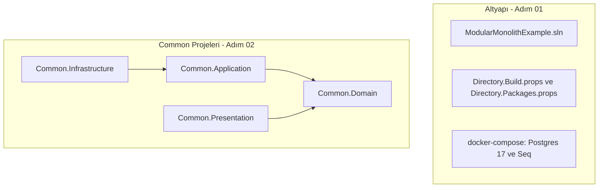
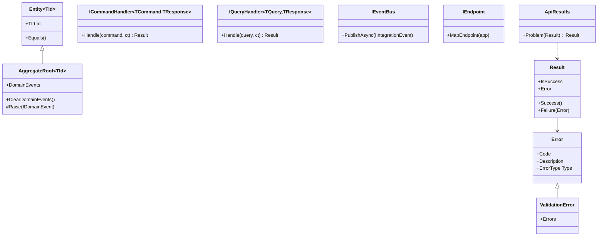
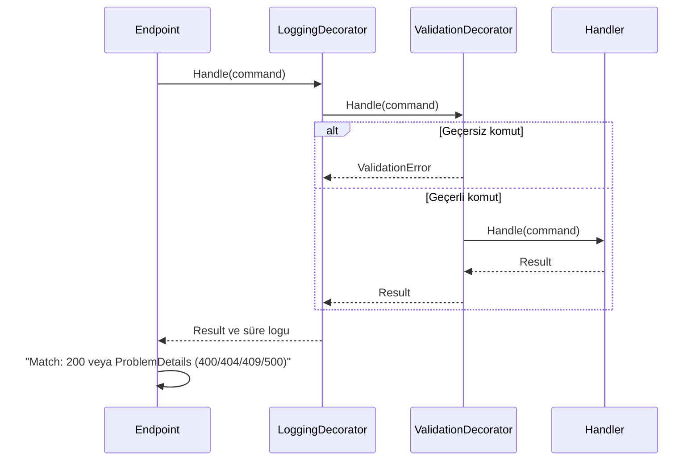
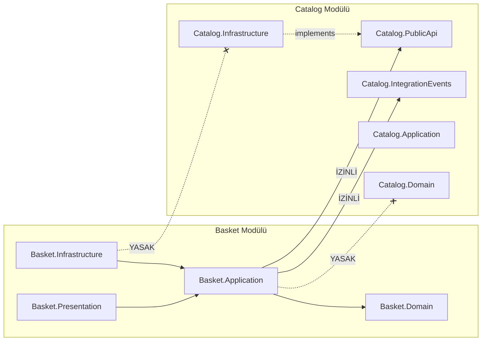
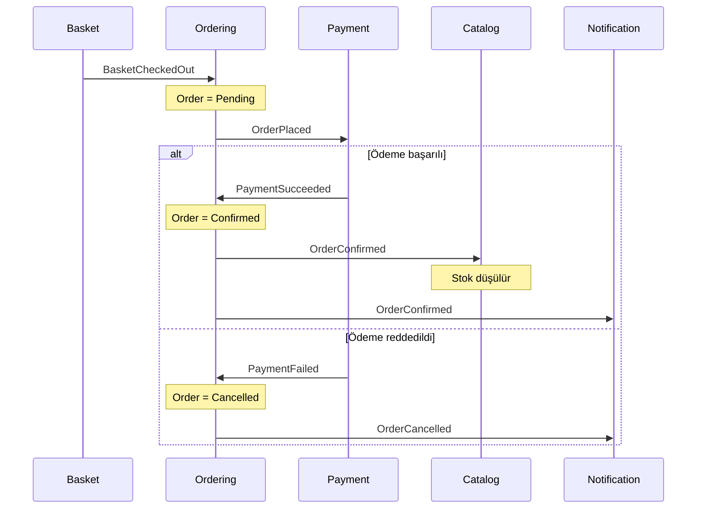
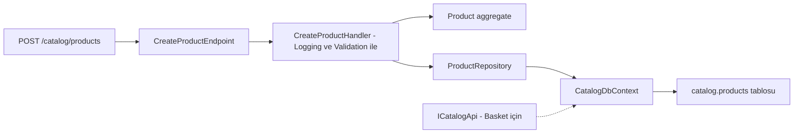

# Mimari ve İlerleme

Bu doküman projenin şu anki durumunu ve hedeflenen mimariyi diyagramlarla özetler. Her adım tamamlandıkça güncellenir.

**Durum:** 11 adımın 2'si tamamlandı. İskelet ve ortak yapı taşları hazır, modüller henüz yok.

## 1. Yol Haritası

```mermaid
flowchart LR
    s01["01 İskelet - TAMAM"] --> s02["02 Common - TAMAM"]
    s02 --> s03["03 Catalog + ilk host - SIRADAKİ"]
    s03 --> s04["04 Basket"]
    s04 --> s05["05 Outbox / Inbox"]
    s05 --> s06["06 Ordering"]
    s06 --> s07["07 Payment"]
    s07 --> s08["08 Notification"]
    s08 --> s09["09 Host son hali"]
    s09 --> s10["10 Testler"]
    s10 --> s11["11 Dokümantasyon"]
```

Adımların detayları: [plan/00-genel-bakis.md](plan/00-genel-bakis.md)

## 2. Şu An Elimizde Olanlar

1. adımda dosya ve altyapı tarafı kuruldu, Postgres ve Seq container'ları çalışıyor. 2. adımda dört ortak proje yazıldı:

Projelerin içindeki temel tipler:

| Proje | İçerik |
|---|---|
| `Common.Domain` | `Entity`, `AggregateRoot`, `DomainEvent`, `Result`, `Error` |
| `Common.Application` | Command/query/handler arayüzleri, `IEventBus`, decorator'lar, `AddApplication()` |
| `Common.Infrastructure` | `AddInfrastructure()` (şimdilik `TimeProvider`); Outbox/Inbox adım 05'te |
| `Common.Presentation` | `IEndpoint`, `ApiResults`, `Match` extension'ları |

## 3. Bir İstek Handler'a Nasıl Ulaşıyor

Adım 02 sonunda smoke test ile doğrulanan zincir:

## 4. Hedef Mimari

Tek süreç, tek deploy birimi; ama her modülün kendi şeması var.

```mermaid
flowchart TB
    client["İstemci / Api.http"] --> api["Api Host - tek deploy birimi"]
    subgraph modules [Modüller]
        catalog["Catalog"]
        basket["Basket"]
        ordering["Ordering"]
        payment["Payment"]
        notification["Notification"]
    end
    api --> catalog
    api --> basket
    api --> ordering
    api --> payment
    api --> notification
    basket -->|"senkron: ICatalogApi"| catalog
    bus["In-memory Event Bus + Outbox/Inbox"]
    basket -.-> bus
    ordering -.-> bus
    payment -.-> bus
    bus -.-> ordering
    bus -.-> payment
    bus -.-> catalog
    bus -.-> notification
    subgraph db [PostgreSQL - tek instance]
        sc["catalog şeması"]
        sb["basket şeması"]
        so["ordering şeması"]
        sp["payment şeması"]
        sn["notification şeması"]
    end
    catalog --> sc
    basket --> sb
    ordering --> so
    payment --> sp
    notification --> sn
```

## 5. Modülün İçi ve Sınır Kuralı

Örnek: Basket modülü Catalog'a nasıl bağlanır. Adım 10'daki architecture testleri bu kuralı otomatik denetler.

Kural: Bir modül başka bir modülün yalnızca `*.PublicApi` ve `*.IntegrationEvents` projelerine referans verebilir.

## 6. Sipariş Akışı (Adım 04 - 08)

Modüller birbirini doğrudan çağırmaz, event'lerle haberleşir:

## 7. Sıradaki Adım: Catalog

Adım 03 sonunda uygulama ilk kez `dotnet run` ile çalışacak.

