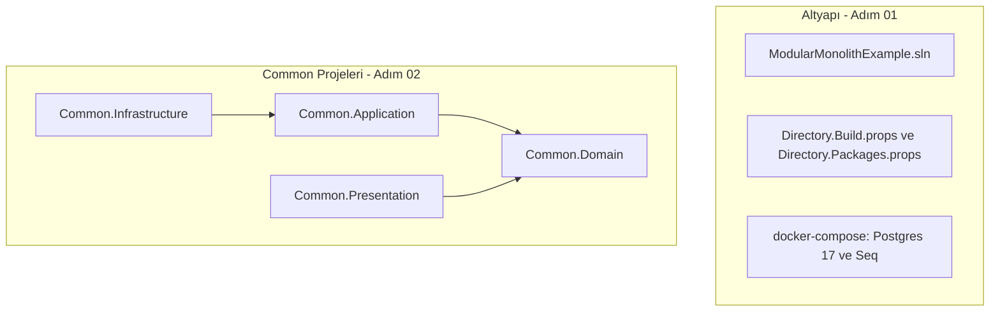
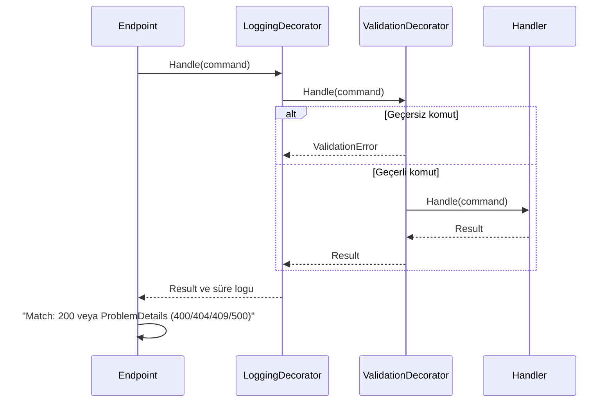
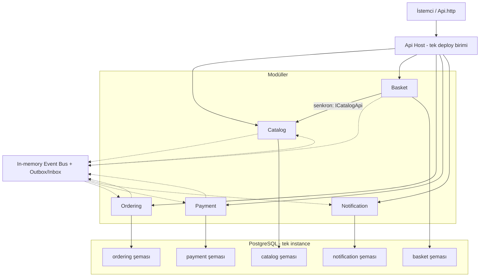
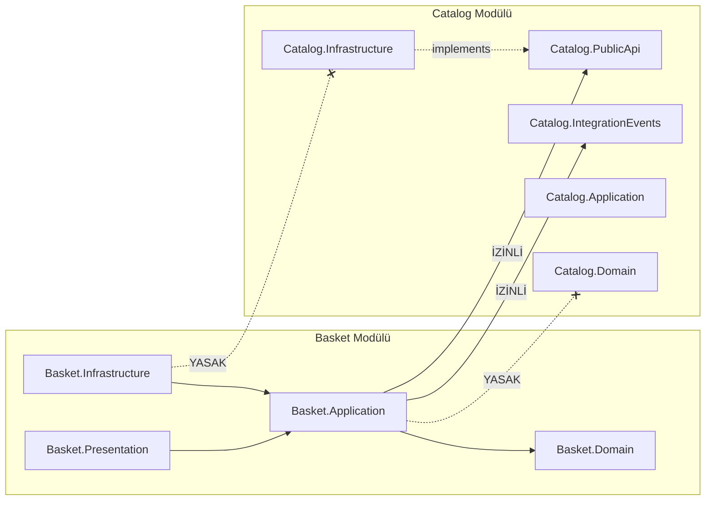
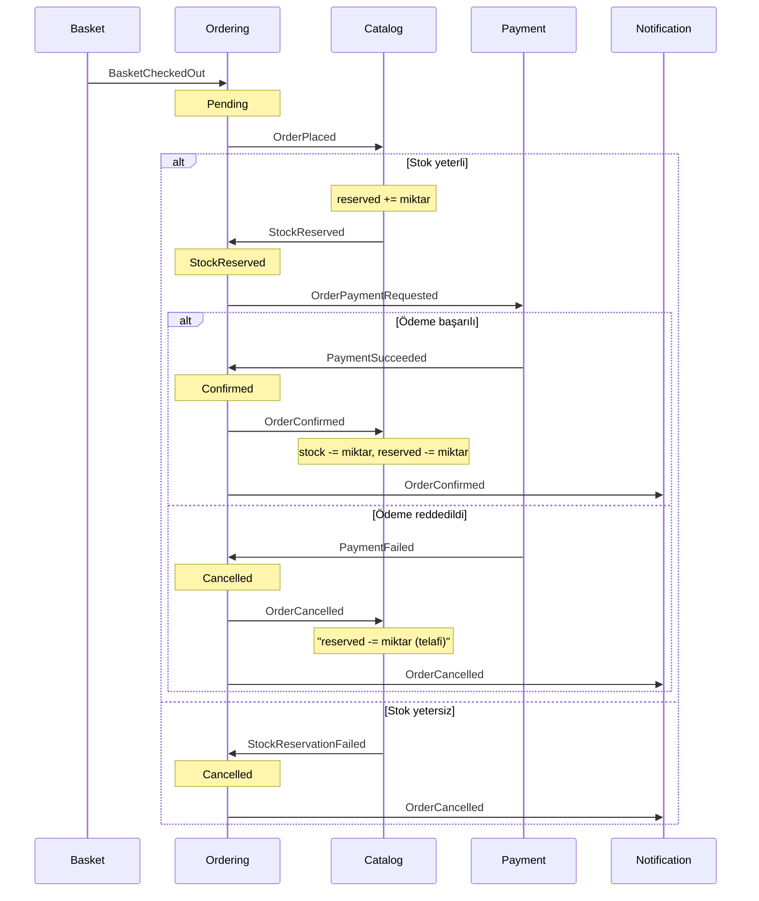
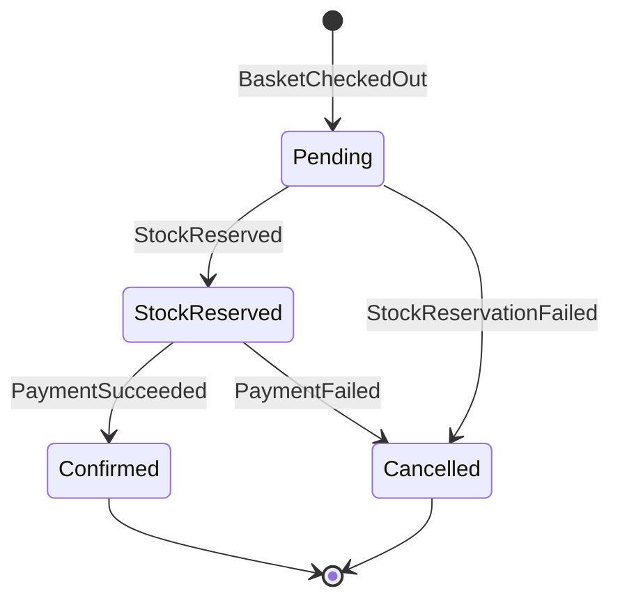
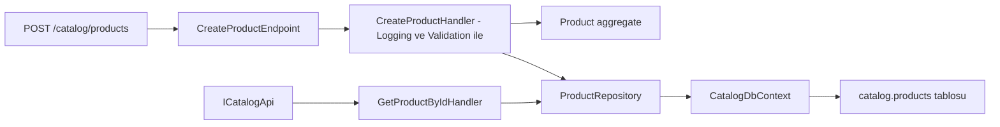
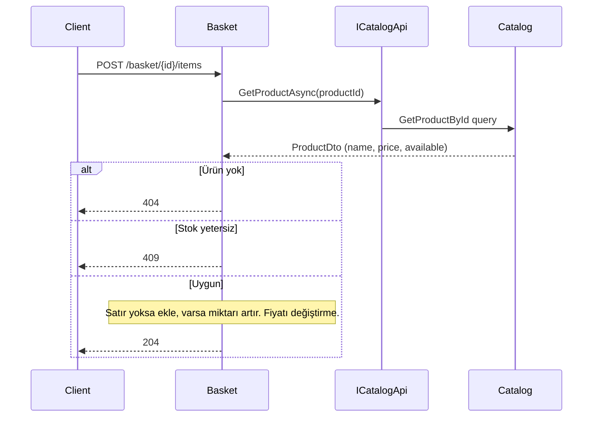

# Mimari ve İlerleme

Bu doküman projenin şu anki durumunu ve hedeflenen mimariyi diyagramlarla özetler. Her adım tamamlandıkça güncellenir.

**Durum:** 11 adımın 4'ü tamamlandı. Catalog ve Basket ayakta; senkron iletişim `ICatalogApi` üzerinden çalışıyor.

## 1. Yol Haritası

```mermaid
flowchart LR
    s01["01 İskelet - TAMAM"] --> s02["02 Common - TAMAM"]
    s02 --> s03["03 Catalog + ilk host - TAMAM"]
    s03 --> s04["04 Basket - TAMAM"]
    s04 --> s05["05 Outbox / Inbox - SIRADAKİ"]
    s05 --> s06["06 Ordering"]
    s06 --> s07["07 Payment"]
    s07 --> s08["08 Notification"]
    s08 --> s09["09 Host son hali"]
    s09 --> s10["10 Testler"]
    s10 --> s11["11 Dokümantasyon"]
```

Adımların detayları: [plan/00-genel-bakis.md](plan/00-genel-bakis.md)

## 2. Şu An Elimizde Olanlar

1. adımda dosya ve altyapı tarafı kuruldu, Postgres ve Seq container'ları çalışıyor. 2. adımda dört ortak proje yazıldı:

Projelerin içindeki temel tipler:

| Proje | İçerik |
|---|---|
| `Common.Domain` | `Entity`, `AggregateRoot`, `DomainEvent`, `Result`, `Error` |
| `Common.Application` | Command/query/handler arayüzleri, `IEventBus`, decorator'lar, `AddApplication()` |
| `Common.Infrastructure` | `AddInfrastructure()` (`TimeProvider`), `AddModuleDbContext()`, `ApplyModuleMigrationsAsync()`; Outbox/Inbox adım 05'te |
| `Common.Presentation` | `IEndpoint`, `ApiResults`, `Match` extension'ları |

## 3. Bir İstek Handler'a Nasıl Ulaşıyor

Adım 02 sonunda smoke test ile doğrulanan zincir:

## 4. Hedef Mimari

Tek süreç, tek deploy birimi; ama her modülün kendi şeması var.

## 5. Modülün İçi ve Sınır Kuralı

Örnek: Basket modülü Catalog'a nasıl bağlanır. Adım 10'daki architecture testleri bu kuralı otomatik denetler.

Kural: Bir modül başka bir modülün yalnızca `*.PublicApi` ve `*.IntegrationEvents` projelerine referans verebilir.

## 6. Sipariş Akışı - Stok Rezervasyonlu Saga (Adım 04 - 08)

Modüller birbirini doğrudan çağırmaz, event'lerle haberleşir. Stok ödemeden önce rezerve edilir, ödeme başarısız olursa serbest bırakılır (telafi). Karar gerekçesi ve event kataloğu: [gereksinimler.md](gereksinimler.md#karar-stok-rezervasyonu-saga--telafi)

Sipariş durum makinesi:

Gereksinimler, endpoint'ler ve senaryolar: [gereksinimler.md](gereksinimler.md)

## 7. Catalog Modülü (Adım 03 - Tamamlandı)

Uygulama ilk kez `dotnet run` ile çalışıyor; S1 senaryosu `Api.http` ile doğrulandı.

## 8. Basket ve Senkron Sınır (Adım 04 - Tamamlandı)

Basket, Catalog'un tablosuna dokunmaz. Ürün bilgisi yalnızca `ICatalogApi` ile istenir; fiyat sepete **snapshot** olarak yazılır.

S2, S3 ve S6 `Api.http` ile doğrulandı. Checkout `BasketCheckedOut` domain event'ini üretir ama henüz yayınlamaz; bu adım 05'te Outbox'a bağlanacak.
