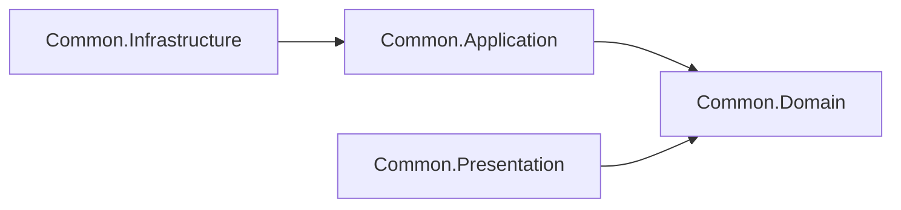

# 02 - Common (Building Blocks)

## Amaç
Tüm modüllerin kullanacağı, **iş mantığı içermeyen** teknik yapı taşlarını oluşturmak.

## Kavram
Common katmanı "shared kernel" değil, teknik altyapıdır. İçine domain kavramı (ör. `Product`) koymak modülleri birbirine bağlar; bu yüzden yalnızca jenerik tipler bulunur.

## Bağımlılıklar

## Yapılacaklar

### Common.Domain
- [x] `Entity<TId>` (Id bazlı eşitlik), `AggregateRoot<TId>` + `IAggregateRoot` (domain event listesi)
- [x] `IDomainEvent`, `DomainEvent` (Id = Guid v7, OccurredOnUtc)
- [x] `Result`, `Result<T>`, `Error`, `ValidationError` (ErrorType: Failure, Validation, NotFound, Conflict)

### Common.Application
- [x] `ICommand`, `ICommand<TResponse>`, `IQuery<TResponse>`
- [x] `ICommandHandler<...>`, `IQueryHandler<...>`
- [x] Decorator'lar: `ValidationDecorator` (FluentValidation), `LoggingDecorator` (`[LoggerMessage]` source generator)
- [x] `IDomainEventHandler<T>` + `DomainEventHandler<T>` taban sınıfı
- [x] `IIntegrationEvent`, `IntegrationEvent`, `IIntegrationEventHandler<T>`, `IEventBus`
- [x] `AddApplication(params Assembly[])`: Scrutor ile `internal` handler taraması + decorator kaydı, validator kaydı
- ~~`IDateTimeProvider`~~ yerine .NET'in yerleşik `TimeProvider`'ı kullanılıyor (testlerde `FakeTimeProvider` ile değiştirilebilir)

### Common.Infrastructure
- [x] `AddInfrastructure()`: `TimeProvider.System` kaydı
- [ ] (Outbox/Inbox ve EventBus adım 05'te eklenecek)

### Common.Presentation
- [x] `IEndpoint` arayüzü (`MapEndpoint(IEndpointRouteBuilder)`)
- [x] `AddEndpoints(assemblies)` / `MapEndpoints()`: assembly taramasıyla endpoint kaydı
- [x] `ApiResults.Problem(Result)` -> ProblemDetails, `Match` extension'ları (namespace: `Common.Presentation.Http`)

## Tasarım Notları
- Handler kaydı Infrastructure yerine Application'da: decorator'lar `internal` olduğu için kaydı aynı assembly'de yapmak, onları dışarı açmaktan daha temiz.
- Decorator sırası: `Logging -> Validation -> Handler`. Geçersiz komut handler'a hiç ulaşmaz ama loglanır.

## Bitti Tanımı
- [x] Common projeleri uyarısız derleniyor
- [x] Common.Domain hiçbir projeye bağımlı değil
- [x] Geçici bir konsol uygulamasıyla decorator zinciri doğrulandı (internal handler bulundu, validation handler'ı engelledi)
