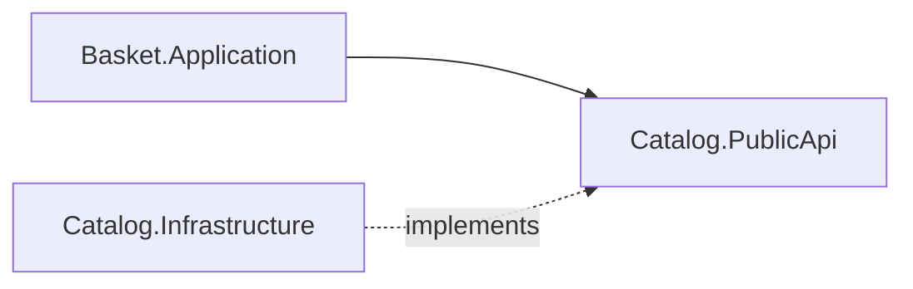

# 04 - Basket Modülü

## Amaç
**Senkron modüller arası iletişimi** doğru şekilde göstermek.

## Kavram
Basket, ürün fiyatını Catalog'un veritabanından **okumaz**; yalnızca `ICatalogApi` üzerinden ister. Basket projeleri sadece `Catalog.PublicApi`'ye referans verir.

Neden böyle: Catalog yarın ayrı bir servis olsa, Basket kodunda değişecek tek şey `ICatalogApi` implementasyonu olur (metot çağrısı -> HTTP). `catalog.products`'a SQL yazmak o kapıyı kapatırdı.

## Yapılacaklar

### Basket.Domain
- [x] `Basket` aggregate (`Id` = `CustomerId`, `Items`)
- [x] `BasketItem` (`ProductId`, `ProductName`, `UnitPrice` Money VO, `Quantity`) - fiyat snapshot'ı
- [x] Davranışlar: `AddItem`, `RemoveItem`, `Checkout` (sepeti temizler)
- [x] Domain event: `BasketCheckedOutDomainEvent` (Outbox ile yayınlama adım 05'te)

### Basket.Application
- [x] `AddItemToBasket` (`ICatalogApi` ile ürün, fiyat ve kullanılabilir stok kontrolü)
- [x] `RemoveItemFromBasket`, `GetBasket` (sepet yoksa boş sepet)
- [x] `CheckoutBasket`: `OrderId` (Guid v7) üretir, sepeti temizler, `OrderId` döner

### Basket.Infrastructure
- [x] `BasketDbContext` (şema: `basket`), `InitialBasket` migration
- [x] `basket_items` üzerinde `(basket_id, product_id)` unique index (aynı üründen tek satır)

### Basket.IntegrationEvents
- [x] `BasketCheckedOutIntegrationEvent` (`OrderId`, `CustomerId`, `Items`, `TotalAmount`)
  - Yayınlama adım 05'te Outbox ile bağlanacak

### Basket.Presentation
- [x] `GET /basket/{customerId}`, `POST /basket/{customerId}/items`, `DELETE /basket/{customerId}/items/{productId}`
- [x] `POST /basket/{customerId}/checkout` -> **202 Accepted** + `{ orderId }` + `Location: /orders/{orderId}`

### Api
- [x] `AddApplication` her iki modül assembly'siyle **tek kez** çağrılır
- [x] `AddBasketModule`, `Api.http`'e S2 / S3 / S6 istekleri

## Tasarım Notları
- `Money` Catalog'dakiyle aynı şekildedir ama **kopyadır**. Common'a taşınmadı: ortak kernel şişmesin, her modül kendi fiyat kavramına sahip olsun.
- Sepete tekrar eklemede fiyat güncellenmez, yalnızca miktar artar (S3). Catalog fiyatı değişse bile sepetteki snapshot durur.
- Stok kontrolü erken bir kontroldür (FR-B4). Asıl güvence adım 06'daki rezervasyondadır.
- `ICatalogApi` implementasyonu Infrastructure'dadır ama `GetProductById` query'sini çalıştırır; stok hesabı domain'de tek yerde kalır.

## Bitti Tanımı
- [x] Senaryolar S2 (ekleme), S3 (fiyat snapshot), S6 (boş sepet) çalışıyor
- [x] Var olmayan ürün sepete eklenemiyor (404 ProblemDetails), stok yetersizse 409
- [x] Basket projelerinde Catalog'un yalnızca PublicApi referansı var
