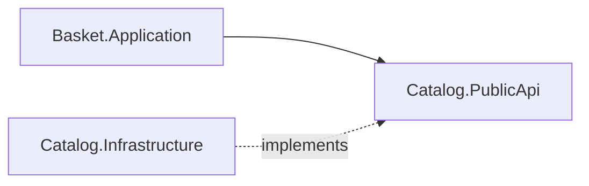

# 04 - Basket Modülü

## Amaç
**Senkron modüller arası iletişimi** doğru şekilde göstermek.

## Kavram
Basket, ürün fiyatını Catalog'un veritabanından **okumaz**; yalnızca `ICatalogApi` üzerinden ister. Basket projeleri sadece `Catalog.PublicApi`'ye referans verir.

## Yapılacaklar

### Basket.Domain
- [ ] `Basket` aggregate (`CustomerId`, `Items`)
- [ ] `BasketItem` (`ProductId`, `ProductName`, `UnitPrice`, `Quantity`) - fiyat snapshot'ı
- [ ] Davranışlar: `AddItem`, `RemoveItem`, `Clear`, `Checkout`
- [ ] Domain event: `BasketCheckedOutDomainEvent`

### Basket.Application
- [ ] `AddItemToBasket` (ICatalogApi ile ürün, fiyat ve kullanılabilir stok kontrolü)
- [ ] `RemoveItemFromBasket`, `GetBasket`
- [ ] `CheckoutBasket`: `OrderId` (Guid v7) üretir, sepeti temizler, `OrderId` döner

### Basket.Infrastructure
- [ ] `BasketDbContext` (şema: `basket`), migration

### Basket.IntegrationEvents
- [ ] `BasketCheckedOutIntegrationEvent` (`OrderId`, `CustomerId`, `Items`, `TotalAmount`)
  - Yayınlama adım 05'te Outbox ile bağlanacak

### Basket.Presentation
- [ ] `GET /basket/{customerId}`, `POST /basket/{customerId}/items`, `DELETE /basket/{customerId}/items/{productId}`
- [ ] `POST /basket/{customerId}/checkout` -> **202 Accepted** + `{ orderId }` + `Location: /orders/{orderId}`

## Bitti Tanımı
- Senaryolar S2 (ekleme), S3 (fiyat snapshot), S6 (boş sepet) çalışıyor
- Var olmayan ürün sepete eklenemiyor (404 ProblemDetails), stok yetersizse 409
- Basket projelerinde Catalog'un yalnızca PublicApi referansı var
