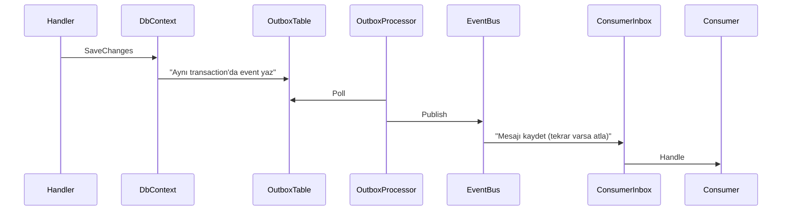

# 05 - Event Bus, Outbox ve Inbox

## Amaç
Modüller arası **güvenilir asenkron iletişim** altyapısını kurmak.

## Kavram
- **Dual-write problemi**: Veriyi kaydedip event'i ayrı yayınlarsak biri başarısız olabilir.
- **Outbox**: Event, iş verisiyle **aynı transaction'da** modülün `outbox_messages` tablosuna yazılır; arka plan işi sonra yayınlar.
- **Inbox**: Tüketen modül mesajı `inbox_messages`'a yazar; aynı mesaj iki kez gelirse tekrar işlemez (idempotency).
- Event bus soyut (`IEventBus`) tutulur; in-memory yerine RabbitMQ konarak modül ayrıştırılabilir.

## Yapılacaklar
- [ ] `OutboxMessage` (Id, Type, Content JSON, OccurredOnUtc, ProcessedOnUtc, Error)
- [ ] `InboxMessage` + `InboxMessageConsumer` (MessageId, ConsumerName)
- [ ] `InsertOutboxMessagesInterceptor`: aggregate'lerdeki domain event'leri outbox'a yazar
- [ ] Domain event -> integration event dönüşümü: modül içinde `IDomainEventHandler` ile
- [ ] `OutboxProcessor<TDbContext>` (`BackgroundService`, modül başına, batch + `FOR UPDATE SKIP LOCKED`)
- [ ] `InMemoryEventBus` (`System.Threading.Channels`) + dispatcher `BackgroundService`
- [ ] `IdempotentIntegrationEventHandler<T>` decorator'ı (Inbox kontrolü)
- [ ] Retry ve hata kaydı (Error kolonu)
- [ ] Her modülün DbContext'ine outbox/inbox tablolarını ekleyen ortak configuration
- [ ] Basket checkout'u bu altyapıya bağla

## Bitti Tanımı
- Checkout sonrası `basket.outbox_messages` tablosuna kayıt düşüyor ve işleniyor (`ProcessedOnUtc` dolu)
- Aynı mesaj iki kez yayınlandığında handler bir kez çalışıyor
