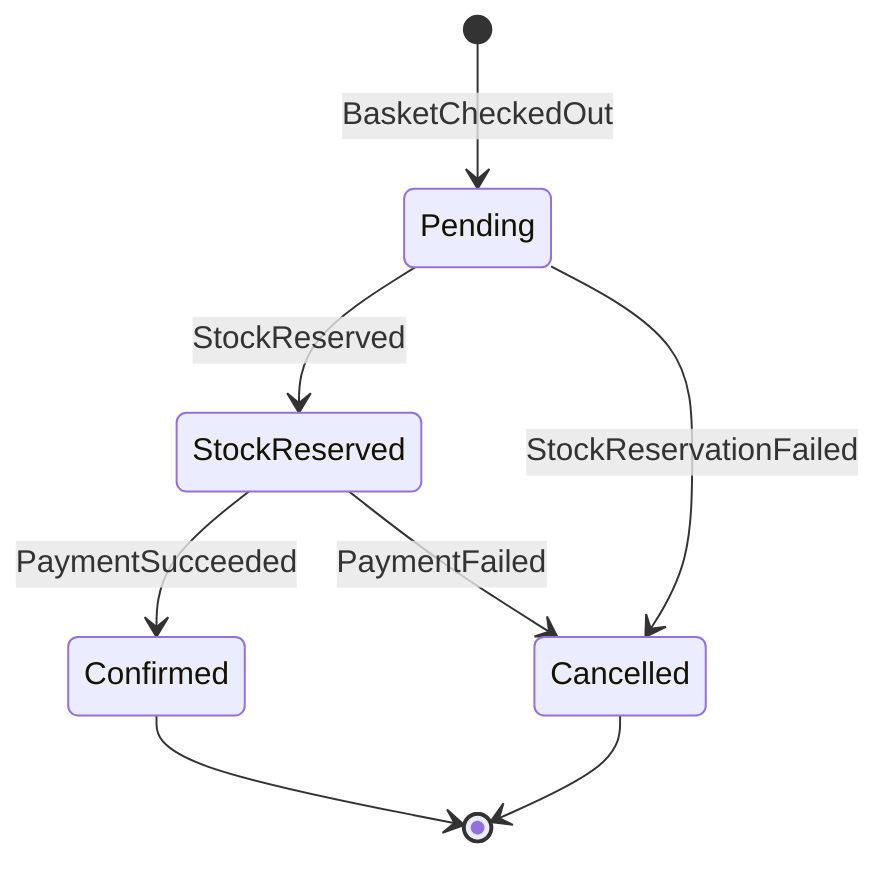

# 06 - Ordering Modülü ve Stok Rezervasyonu

## Amaç
Event'lerle yönlendirilen, **durum makinesine** sahip bir aggregate kurmak ve stok rezervasyonu ile choreography tabanlı bir saga oluşturmak.

## Kavram
- Ordering hiçbir modülü doğrudan çağırmaz; yalnızca event dinler ve event yayınlar.
- Sipariş durumu saga'nın durumunu tutar. Merkezi bir orchestrator yoktur.
- Stok ödemeden **önce** rezerve edilir; ödeme başarısız olursa rezervasyon serbest bırakılır (telafi).
- Karar ve tam event akışı: [../gereksinimler.md](../gereksinimler.md#karar-stok-rezervasyonu-saga--telafi)

## Durum Makinesi

## Yapılacaklar

### Ordering.Domain
- [ ] `Order` aggregate (`CustomerId`, `Lines`, `TotalAmount`, `Status`, `CancellationReason`)
- [ ] Davranışlar: `Place`, `MarkStockReserved`, `Confirm`, `Cancel(reason)`
- [ ] Geçersiz durum geçişlerinde hata (ör. `Cancelled` -> `Confirmed`)
- [ ] Domain event'ler: `OrderPlaced`, `OrderStockReserved`, `OrderConfirmed`, `OrderCancelled`

### Ordering.Application
- [ ] `BasketCheckedOut` -> `Place` -> `OrderPlaced` yayınla
- [ ] `StockReserved` -> `MarkStockReserved` -> `OrderPaymentRequested` yayınla
- [ ] `StockReservationFailed` -> `Cancel("Yetersiz stok")` -> `OrderCancelled` yayınla
- [ ] `PaymentSucceeded` -> `Confirm` -> `OrderConfirmed` yayınla
- [ ] `PaymentFailed` -> `Cancel("Ödeme reddedildi")` -> `OrderCancelled` yayınla
- [ ] Query'ler: `GetOrderById`, `GetOrdersByCustomer`

### Ordering.IntegrationEvents
- [ ] `OrderPlacedIntegrationEvent` (OrderId, Lines: ProductId + Quantity)
- [ ] `OrderPaymentRequestedIntegrationEvent` (OrderId, CustomerId, Amount)
- [ ] `OrderConfirmedIntegrationEvent` (OrderId, CustomerId)
- [ ] `OrderCancelledIntegrationEvent` (OrderId, CustomerId, Reason)

### Ordering.Infrastructure / Presentation
- [ ] `OrderingDbContext` (şema: `ordering`), migration
- [ ] `GET /orders/{orderId}`, `GET /orders?customerId=`

### Catalog'a ek: Stok rezervasyonu
- [ ] `Product`: `Reserve(qty)`, `CommitReservation(qty)`, `ReleaseReservation(qty)`
- [ ] `StockReservation` aggregate (`OrderId`, satırlar, `Status`: Reserved / Committed / Released)
- [ ] `OrderPlaced` handler: tüm satırları tek transaction'da rezerve et -> `StockReserved` veya `StockReservationFailed`
- [ ] Eşzamanlılık: `Product` üzerinde optimistic concurrency (PostgreSQL `xmin`). Çakışmada handler tekrar denenir
- [ ] `Catalog.IntegrationEvents`: `StockReservedIntegrationEvent`, `StockReservationFailedIntegrationEvent`
- [ ] Catalog projesi `Ordering.IntegrationEvents`'e referans verir. Bu, izin verilen tek bağımlılık türüdür
- [ ] `OrderConfirmed` ve `OrderCancelled` handler'ları adım 08'de eklenecek

## Bitti Tanımı
- Checkout sonrası sipariş `Pending` -> `StockReserved` durumuna geçiyor
- Stok yetersizse sipariş `Cancelled` oluyor (senaryo S10'un ilk yarısı)
