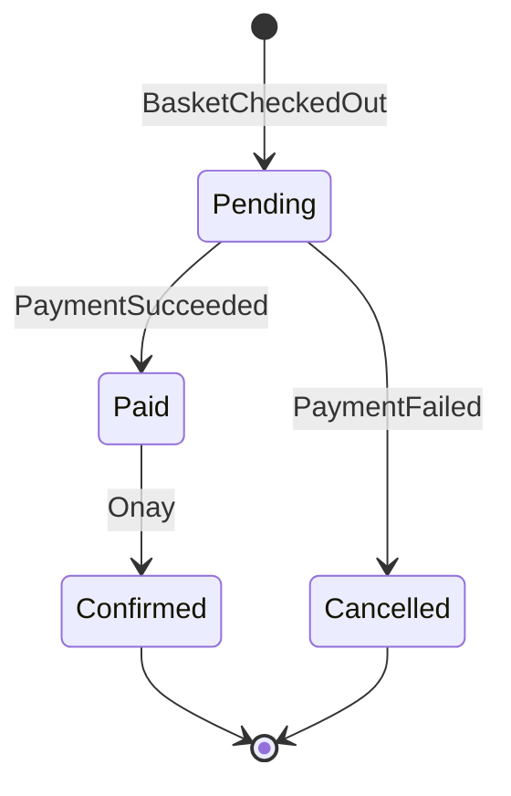

# 06 - Ordering Modülü

## Amaç
Event'lerle yönlendirilen, **durum makinesine** sahip zengin bir aggregate kurmak (choreography tabanlı saga).

## Kavram
Ordering hiçbir modülü doğrudan çağırmaz; yalnızca event dinler ve event yayınlar.

## Durum Makinesi

## Yapılacaklar

### Ordering.Domain
- [ ] `Order` aggregate (`CustomerId`, `Lines`, `TotalAmount`, `Status`)
- [ ] Geçersiz durum geçişlerinde hata (ör. Cancelled -> Paid)
- [ ] Domain event'ler: `OrderPlaced`, `OrderConfirmed`, `OrderCancelled`

### Ordering.Application
- [ ] `BasketCheckedOutIntegrationEventHandler` -> `PlaceOrder`
- [ ] `PaymentSucceededIntegrationEventHandler` -> `MarkAsPaid` + `Confirm`
- [ ] `PaymentFailedIntegrationEventHandler` -> `Cancel`
- [ ] Query'ler: `GetOrderById`, `GetOrdersByCustomer`

### Ordering.IntegrationEvents
- [ ] `OrderPlacedIntegrationEvent` (OrderId, Amount)
- [ ] `OrderConfirmedIntegrationEvent` (OrderId, CustomerId, Lines)
- [ ] `OrderCancelledIntegrationEvent` (OrderId, Reason)

### Ordering.Infrastructure / Presentation
- [ ] `OrderingDbContext` (şema: `ordering`), migration
- [ ] `GET /orders/{id}`, `GET /orders?customerId=`

## Bitti Tanımı
- Checkout sonrası sipariş `Pending` olarak oluşuyor ve `OrderPlaced` yayınlanıyor
